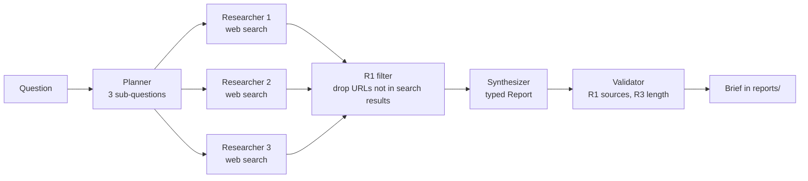

# Agentic AI in Java

A hands-on path from "first API call" to "evaluated, production-minded agents", using the
official Anthropic Java SDK (`com.anthropic:anthropic-java`). Java 20, Maven.

## Capstone: Research Assistant Agent

One research question in, a cited brief of at most 500 words out. Built on Claude Haiku 5.5 with
Anthropic's server-side web search. Code: [`src/main/java/org/example/capstone/`](src/main/java/org/example/capstone/).

What makes it more than a prompt:
- **Guardrails in code, not only in prompts:** every cited URL must come from a real search result
  (invented URLs are removed, near-misses snapped to the real one); a word limit; empty briefs rejected.
- **Cost limits:** hard cap per run and per stage, 15-call limit; a $0.01 cap ends in a partial
  "INCOMPLETE" brief, not an exception.
- **Failure handling:** a failed or slow researcher is dropped and the run continues; the synthesizer
  is retried once; a dead-server fault test runs for free.
- **Prompt-injection test:** 5/5 cases pass (override, fake source, prompt leak, language switch).
- **Eval set:** 10 questions with known facts and an automatic grader, baseline (one agent) vs pipeline.

Results on the 10-question eval (one run per question, one small model):

| | valid briefs | expected facts found | invented URLs | cost per run | time | calls |
|---|---|---|---|---|---|---|
| Pipeline (planner + 3 researchers + synthesizer) | 10/10 | 93% | 0 | $0.07 | 18 s | 5 |
| Single searching agent (baseline) | about 9/10 | about 93-97% | 0 | $0.03 | 8-16 s | 1 |

The honest finding: on these mostly simple lookups one searching agent covers about as many facts at
under half the cost. The team's gains are validity and the comparison question. It would need
harder, multi-part questions to justify itself. The baseline numbers mix two configurations.

The full step-by-step log, every failure and what it taught (thinking tokens count against
`maxTokens`, no thinking means no search, validators must check things exist) is in
[CAPSTONE.md](CAPSTONE.md). [`langgraph-version/`](langgraph-version/) is an untested sketch of the same
pipeline as a LangGraph graph.

Run it: `mvn -q compile exec:java -Dexec.mainClass=org.example.capstone.Main -Dexec.args="Your question"`

## Setup

1. Get an API key at https://console.anthropic.com and export it:
   `export ANTHROPIC_API_KEY=sk-ant-...`
2. Run any program (package `org.example`):
   `mvn -q compile exec:java -Dexec.mainClass=org.example.lesson01.HelloClaude`

Most programs make real API calls and cost a fraction of a cent to a few cents per run.
All lessons use `claude-opus-5-5`; change the model string to try others.

## Curriculum

| # | Program (`org.example.…`) | You learn |
|---|---------------------------|-----------|
| 1 | `lesson01.HelloClaude` | Client, messages, content blocks, tokens, stop reasons |
| 2 | `lesson02.ChatLoop` | The API is stateless; history lives in your code (`RESEND_HISTORY` flag) |
| 3 | `lesson03.ToolRoundTrip` | Tool schemas, `tool_use` / `tool_result`, error results (`SIMULATE_ERROR` flag) |
| 4 | `lesson04.AgentLoop` | The agent loop, multiple tool calls per step, retries, step limit |
| 5 | `lesson05.CodingAgent` | File + shell tools, path sandbox, human approval prompts |
| 6a | `lesson06.PromptCaching` | Cache breakpoints, reading cache usage, cost savings |
| 6b | `lesson06.ManualCompaction` | Summarizing old history to keep context small |
| 7 | `lesson07.Workflows` | Chaining, routing, parallelization, orchestrator-workers |
| 8a | `lesson08.McpConnector` | MCP connector: remote tool servers, no loop to write |
| 8b | `lesson08.Subagents` | A subagent is another agent loop started by a tool call |
| 9a | `lesson09.Evals` | Exact-match, behavior and LLM-as-judge evals, pass rates |
| 9b | `lesson09.Guardrails` | Budgets, redaction, prompt injection (runs offline, free) |

Lesson 7 shares a small helper, `lesson07.Llm`, which lesson 9a reuses.

## Notes and gotchas

- **Parallel tool calls:** Claude can request several tools in one response, but the Lesson 4
  code runs them one after another. Results still go back together in one message. Run them
  concurrently (e.g. `parallelStream`) when tools do slow I/O.
- **Prompt caching** only works above a minimum prefix size; check `cacheCreationInputTokens`
  and `cacheReadInputTokens` to confirm it works.
- **Approval prompts are not a security boundary.** Lesson 5's shell tool can do anything your
  user can; use a container for untrusted tasks.
- **MCP connector** needs a public HTTPS server URL (Lesson 8a defaults to DeepWiki; pass your
  own as the first argument if it fails).

## Reading alongside

- Anthropic: "Building Effective Agents"
- Anthropic docs: Tool use, Agent SDK, MCP
